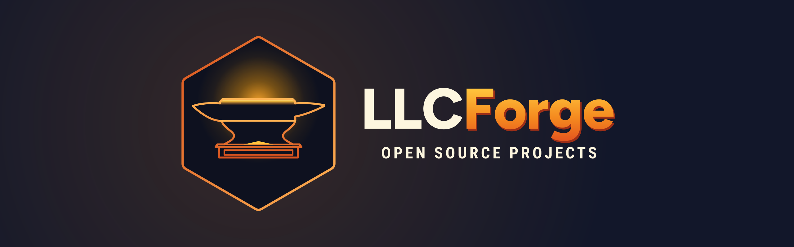

<!-- ═══════════════════════════ HEADER ═══════════════════════════ -->

<p align="center">
  
</p>

<p align="center">
  
</p>

<p align="center">
  <a href="https://github.com/ForgeLLC"></a>
  <a href="https://github.com/cveForge"></a>
  
</p>


<!-- ═══════════════════════════ ABOUT ═══════════════════════════ -->

## `> cat about.rs`

```rust
/// No face. No voice. Just a process.
pub struct ForgeLLC {
    role:       &'static str,
    based_in:   &'static str,
    languages:  [&'static str; 3],
    focus:      &'static [&'static str],
    building:   &'static str,
    philosophy: &'static str,
}

impl ForgeLLC {
    pub const fn new() -> Self {
        Self {
            role:       "Security researcher & open-source developer",
            based_in:   "Malta 🇲🇹",
            languages:  ["Rust", "Go", "TypeScript/WASM"],
            focus:      &[
                "Vulnerability research & CVE analysis",
                "Reverse engineering & binary analysis",
                "Deobfuscation & code analysis",
                "Network security & edge defense",
                "Developer tooling & automation",
            ],
            building:   "Defensive security tooling at @cveForge",
            philosophy: "Understand how it breaks. Then make it unbreakable.",
        }
    }
}
```


<!-- ═══════════════════════════ FOCUS ═══════════════════════════ -->

## `> ls ~/focus/`

<table>
<tr>
<td width="50%" valign="top">

### 🔍 Research
- **CVE analysis** — root cause, patch diffing, variant hunting
- **Reverse engineering** — binaries, bytecode, protocols
- **Deobfuscation** — making hostile code readable again
- **Coordinated disclosure** — private first, public after the fix

</td>
<td width="50%" valign="top">

### 🛠️ Engineering
- **Systems tooling** — fast, memory-safe engines in Rust
- **Network defense** — traffic inspection, WAF, DDoS mitigation
- **Browser & WASM** — portable analysis in the browser
- **Automation** — agents, workflows and developer tools

</td>
</tr>
</table>


<!-- ═══════════════════════════ STACK ═══════════════════════════ -->

## `> cargo tree --depth 1`

<p align="center">
  <br><br>
  
</p>

<div align="center">

| Domain | Toolbox |
|:--|:--|
| **Languages** | Rust · Go · TypeScript · Python · C/C++ |
| **Low level** | x86-64 · ARM64 · eBPF · WebAssembly |
| **Analysis** | Disassemblers · debuggers · fuzzers · traffic interceptors |
| **Infra** | Linux · Docker · Nginx · PostgreSQL · Redis |
| **Web** | Next.js · Fastify · Tauri |

</div>


<!-- ═══════════════════════════ STATS ═══════════════════════════ -->

## `> git log --stat`

<p align="center">
  
  
</p>

<p align="center">
  
</p>

<p align="center">
  
</p>


<!-- ═══════════════════════════ PRINCIPLES ═══════════════════════════ -->

## `> cat /etc/principles`

```text
[01]  Understand before you build.      Read the code. Read the spec. Read the patch.
[02]  Defense is the point.             Every tool should make a defender's day easier.
[03]  Memory safety is not optional.    Rust where it counts, unsafe where it must.
[04]  Disclose responsibly.             Vendor first, public after the fix. Always.
[05]  Open by default.                  MIT / Apache-2.0. Knowledge locked away protects no one.
[06]  Ship small, ship often.           A working tool beats a perfect plan.
```


<!-- ═══════════════════════════ ORG ═══════════════════════════ -->

## `> ls ~/orgs/`

<table>
<tr>
<td width="110" align="center">
  <a href="https://github.com/cveForge">
    
  </a>
</td>
<td>

**[cveForge](https://github.com/cveForge)** — open-source security research organization.
Defensive tooling for CVE research, binary analysis and vulnerability disclosure.

</td>
</tr>
</table>


<!-- ═══════════════════════════ CONTACT ═══════════════════════════ -->

## `> ./contact.sh`

<div align="center">

| | |
|:--|:--|
| 🔐 **Security issue in one of my projects?** | Use *Private Vulnerability Reporting* on the repo — please no public issues |
| 💬 **Ideas, questions, collaboration** | Open a Discussion or an Issue on the relevant repository |
| 🤝 **Want to contribute?** | Read `CONTRIBUTING.md`, fork, and send a focused PR |

</div>

<!-- ═══════════════════════════ FOOTER ═══════════════════════════ -->

<br>

<p align="center">
  <picture>
    <source media="(prefers-color-scheme: dark)" srcset="https://raw.githubusercontent.com/ForgeLLC/ForgeLLC/main/assets/forgellc-wordmark-dark.svg">
    <source media="(prefers-color-scheme: light)" srcset="https://raw.githubusercontent.com/ForgeLLC/ForgeLLC/main/assets/forgellc-wordmark-light.svg">
    
  </picture>
</p>

<p align="center">
  <sub><code>process exited with code 0</code> · <i>the forge never goes cold</i> 🔥</sub>
</p>

<p align="center">
  
</p>
